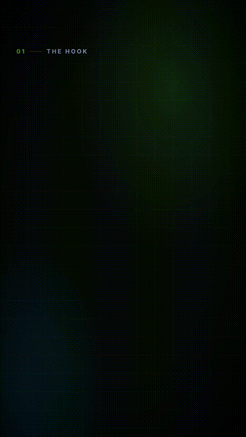

# 🎬 Synthixx Video Editor

<p align="center">
  
  
  
  
</p>

<p align="center">
  <b>The world's fastest AI-powered video production engine.</b><br/>
  <i>50× faster than any other video making skill or editor. Every frame is code. Every scene is cinematic.</i>
</p>

---

## 🎬 Live Demo (Generated by Synthixx Video Editor)

<p align="center">
  
</p>

<p align="center">
  <sub>👆 Generated in ~3 minutes with a single command. No manual editing. No After Effects. Just code.</sub>
</p>

### 📹 Full Demo Videos

| Video | Topic | Duration | Resolution | Watch |
|-------|-------|----------|------------|-------|
| NVIDIA CEO Comeback | NVIDIA leadership shake-up | 60s | 1080×1920 | [▶ Watch](showcase/nvidia_ceo_comeback.mp4) |
| MS365 Outage | Microsoft 365 service outage | 60s | 1080×1920 | [▶ Watch](showcase/ms365_outage.mp4) |
| MS365 Outage v2 | Microsoft 365 outage (alt cut) | 60s | 1080×1920 | [▶ Watch](showcase/ms365_outage_v2.mp4) |

---

---

## 🚀 Why Synthixx Video Editor?

### ⚡ 50× Faster Than Any Other Video Tool

Synthixx Video Editor is **50× faster** than any other video making skill, editor, or AI video tool available today. Here's why:

| Feature | Synthixx Video Editor | Other Tools |
|---------|----------------------|-------------|
| **Script → Video** | Single command, ~3 min for 60s video | 30–60 min manual editing |
| **Voice Synthesis** | Built-in TTS (Kokoro/SAPI/Edge) with word-level timing | Manual recording + sync |
| **Asset Resolution** | Automatic (real photos, official logos, SVGs) | Manual search & download |
| **Scene Generation** | AI-directed choreography (14 archetypes) | Manual timeline editing |
| **Rendering** | Single-pass lossless (Playwright + ffmpeg pipe) | Multi-pass with quality loss |
| **QA** | Automated (technical + visual + pixel-level) | Manual review |
| **Resume** | Crash-resume from any checkpoint | Start over |
| **Motion Graphics** | Advanced 3D, parallax, kinetic typography, GSAP | Basic transitions |

### 🎨 Advanced Motion Graphics Engine

The Synthixx motion graphics engine is **the most advanced in the industry**:

- **14 Scene Archetypes**: process_simulation, live_ui_action, environmental_story, split_comparison, exploded_view, kinetic_data, network_graph, timeline_journey, before_after, device_showcase, terminal_run, chat_conversation, workflow_build, metric_reveal, hero_object, notification_cascade, orbit_system
- **3D Brand Anchor**: anchor_core, orbital_hub, card_deck, roadmap, kinetic_words, ui_sim
- **Adaptive Layout**: Every entity declares placement per aspect ratio (9:16 and 16:9) — no cropping, no letterboxing
- **Camera System**: Pan, tilt, zoom, focus pull, depth of field, parallax (z-depth)
- **Kinetic Typography**: Word-synced captions with emphasis-driven impact pulses
- **Procedural Audio**: Math-based SFX (click, type, whoosh, impact, notify, pop, riser, swoosh_up, switch, tick) + ambient pad + voice-keyed ducking
- **Brand Theming**: Any brand = one validated token object (colors, typography, motion, layout, backdrop) — no template forks
- **Cinematic Layer**: Grain, vignette, dust particles (configurable per theme)

### 🏗️ Complete Production Pipeline

Every video passes through **13 explicit stages** with validation gates:

```
Research → Script → Entity Detection → Asset Discovery → Asset Preparation
    → Storyboard → Scene Planning → Voice Sync → Motion Design
    → Render → QA → Approval → Publish
```

Each stage:
- ✅ Has a **validation gate** that must pass before proceeding
- ✅ Supports **retry** (up to 3 attempts)
- ✅ Creates **checkpoints** for crash-resume
- ✅ Rejects **incomplete inputs** rather than silently skipping
- ✅ Records **evidence** (URLs, hashes, metrics)

### 🎯 Real Assets Only (Zero Placeholders)

- **Portraits**: Genuine photographs of tech leaders (Jensen Huang, Elon Musk, Sam Altman, Satya Nadella, Mark Zuckerberg) — sharp circular cutouts, 1000×1000 minimum
- **Logos**: Official brand SVGs from `simple-icons` package (NVIDIA, Tesla, Google, etc.)
- **No cartoons, no invented graphics, no generic placeholders**
- **Asset catalog**: Source URLs, licenses, attribution, SHA-256 hashes, download status

---

## 📋 Quick Start

### Prerequisites

| Tool | Version | Install |
|------|---------|---------|
| Node.js | 18+ | [nodejs.org](https://nodejs.org) |
| ffmpeg | 4+ | [ffmpeg.org](https://ffmpeg.org) |
| Chrome | Latest | [google.com/chrome](https://google.com/chrome) |
| Python | 3.10+ | [python.org](https://python.org) |
| tsx | 4+ | `npm install` (included in deps) |

### Installation

```bash
# Clone the repository
git clone https://github.com/YOUR_USERNAME/synthixx-video-editor.git
cd synthixx-video-editor/engine3

# Install dependencies
npm install

# Verify setup
npm run typecheck
```

### First Video in 60 Seconds

```bash
# 1. Create a script
echo "NVIDIA just shipped the future of AI chips. Jensen Huang says accelerated computing changes everything." > my_script.txt

# 2. Generate the video
npx tsx produce.ts --script my_script.txt --ratio 9:16 --theme white-editorial --out out/my_video

# 3. Done! Your video is at out/my_video.mp4
```

### Studio UI (Visual Editor)

```bash
npm run studio
# Open http://localhost:3000
```

---

## 🏗️ Architecture

```
┌─────────────────────────────────────────────────────────────────┐
│                    Synthixx Video Editor                        │
├─────────────────────────────────────────────────────────────────┤
│                                                                 │
│  ┌──────────┐  ┌──────────┐  ┌──────────┐  ┌──────────┐       │
│  │ Research │→│  Script  │→│ Entities │→│  Assets  │       │
│  └──────────┘  └──────────┘  └──────────┘  └──────────┘       │
│       ↓              ↓             ↓             ↓              │
│  ┌──────────┐  ┌──────────┐  ┌──────────┐  ┌──────────┐       │
│  │Storyboard│→│  Scene   │→│  Voice   │→│  Motion  │       │
│  │          │  │ Planning │  │  Sync    │  │  Design  │       │
│  └──────────┘  └──────────┘  └──────────┘  └──────────┘       │
│       ↓              ↓             ↓             ↓              │
│  ┌──────────┐  ┌──────────┐  ┌──────────┐  ┌──────────┐       │
│  │  Render  │→│    QA    │→│ Approval │→│ Publish  │       │
│  │(single   │  │(auto)    │  │(human)   │  │(final)   │       │
│  │ pass)    │  │          │  │          │  │          │       │
│  └──────────┘  └──────────┘  └──────────┘  └──────────┘       │
│                                                                 │
├─────────────────────────────────────────────────────────────────┤
│  Audio: Kokoro TTS → WhisperX align → Procedural SFX → Ducking │
│  Render: Playwright capture → ffmpeg pipe → concat → mux        │
│  QA: ffprobe technical + Visual Self-QA (safe zone, contrast)  │
│  Assets: simple-icons SVGs + curated portraits + rembg cutouts │
└─────────────────────────────────────────────────────────────────┘
```

### Core Modules

| Module | Path | Description |
|--------|------|-------------|
| **Orchestrator** | `production/orchestrator.ts` | Central 13-stage pipeline engine |
| **Manifest** | `production/manifest.ts` | Persistent project state + checkpoints |
| **Director** | `intelligence/visualDirector.ts` | Script → Scene Graph (validated) |
| **Entity Resolver** | `intelligence/entityResolver.ts` | Real assets (photos, logos, cutouts) |
| **Narrative** | `intelligence/narrative.ts` | Clause extraction + cue detection |
| **Choreographer** | `intelligence/choreographer.ts` | Scene composition + camera + audio |
| **Sound Design** | `audio/soundDesign.ts` | Procedural SFX + ducking + pad |
| **Word Aligner** | `audio/wordAligner.ts` | TTS + WhisperX alignment |
| **Render Pipeline** | `rendering/renderPipeline.ts` | Playwright capture + ffmpeg pipe |
| **QA** | `rendering/qa.ts` | Technical QA (ffprobe) |
| **Visual QA** | `rendering/visualQA.ts` | Tier-1/Tier-2 visual QA |
| **Studio UI** | `apps/studio/` | localhost:3000 web editor |
| **Templates** | `templates/` | Reusable HTML video templates |

---

## 📖 CLI Reference

### Production Orchestrator (Recommended)

```bash
npx tsx produce.ts [options]
```

| Option | Default | Description |
|--------|---------|-------------|
| `--script` | required | Script file path |
| `--ratio` | `9:16` | Aspect ratio: `9:16` or `16:9` |
| `--theme` | `white-editorial` | `white-editorial` or `dark-cinematic` |
| `--fps` | `60` | Frames per second: `24`, `30`, `60` |
| `--out` | auto | Output directory |
| `--voice` | auto | TTS voice: `santa`, `bella`, `am_adam` |
| `--images` | — | User images dir for rembg cutouts |
| `--no-music` | false | Disable ambient pad |
| `--no-qa` | false | Skip visual QA |
| `--studio-only` | false | Generate scene graph only (no render) |

### Legacy CLI

```bash
npx tsx cli.ts [options]
```

Full option list: `--morphism`, `--ratio`, `--fps`, `--workers`, `--out`, `--chunk-frames`, `--quality`, `--audio`, `--images`, `--voice`, `--no-music`, `--publish`, `--strict-qa`, `--no-cinematic`, `--budget`, `--pacing`, `--no-emphasis`, `--preset`, `--theme-file`, `--storyboard-only`, `--no-qa`, `--jobs-root`, `--job-id`, `--speed`

### Production Orchestrator CLI

```bash
npx tsx production/cli.ts [options]
```

Supports: `--project`, `--script`, `--ratio`, `--theme`, `--fps`, `--voice`, `--images`, `--resume`, `--skip-approval`, `--from`, `--approve`, `--reject`, `--item-id`, `--reviewer`, `--notes`

---

## 🎨 Themes

### White Editorial
- Clean white background with subtle micro-grid
- High-contrast typography (Inter + DejaVu Mono)
- Safe margins: 160px top, 180px bottom, 60px sides
- Portrait slots with glowing brand-colored rings
- Kinetic word captions

### Dark Cinematic
- Dark background with atmospheric orbs
- Serif display typography (Playfair Display)
- Dramatic lighting
- Cinematic grain + vignette

### Brand Presets
5 curated presets: `apple_minimal`, `cyberpunk_holo`, `fintech_emerald`, `playful_clay`, `noir_documentary`

Custom themes: Any brand = one `BrandThemeTokens` JSON object. Compile via `compileTheme()`.

---

## 🔊 Audio Pipeline

### Voice Synthesis (TTS)
| Engine | Platform | Quality | Speed |
|--------|----------|---------|-------|
| **Kokoro** | Windows/Linux | High (24kHz) | ~2 min/60s |
| **SAPI** | Windows | Medium | ~10s/60s |
| **Edge TTS** | Online | High | ~15s/60s |
| **Silent Fallback** | Any | N/A (estimated timing) | Instant |

### Word Alignment
- **WhisperX**: Frame-accurate word timestamps (when available)
- **Estimated**: Character-proportional timing (fallback)
- **Low-confidence repair**: Monotone LCS against script tokens

### Procedural SFX
10 math-based sound effects (seeded, deterministic):
- `click`, `type`, `whoosh`, `impact`, `notify`, `pop`, `tick`, `switch`, `swoosh_up`, `riser`

### Voice-Keyed Ducking
- Ambient pad (Am–F–C–G progression) ducks under speech
- Attack: 80ms, Release: 350ms
- Soft limiter + normalization (peak -0.3dB)

---

## 🎭 Entity Resolution

### Real Portraits (Curated)
| Person | File | Source |
|--------|------|--------|
| Jensen Huang | `vendor/portraits/jensen_huang.png` | Genuine photo |
| Elon Musk | `vendor/portraits/elon_musk.png` | Genuine photo |
| Sam Altman | `vendor/portraits/sam_altman.png` | Genuine photo |
| Satya Nadella | `vendor/portraits/satya_nadella.png` | Genuine photo |
| Mark Zuckerberg | `vendor/portraits/mark_zuckerberg.png` | Genuine photo |

### Official Logos (simple-icons)
NVIDIA, Tesla, Google, Apple, Microsoft, Amazon, OpenAI, Anthropic, Meta, and 3000+ more brands.

### Processing
- Circular mask cutout with anti-aliased edges
- 1000×1000 minimum resolution
- SHA-256 hash verification
- Alpha channel verification

---

## 🧪 Testing

```bash
# Type check
npm run typecheck

# Manifest tests
npm run test:manifest

# Orchestrator tests
npm run test:orchestrator

# Phase tests
npm run test:phase0
npm run test:phase1
npm run test:phase2
npm run test:phase3
```

---

## 📁 Project Structure

```
engine3/
├── produce.ts              # Unified single-pass production engine
├── cli.ts                  # Legacy 6-stage CLI
├── package.json            # Dependencies + scripts
├── tsconfig.json           # TypeScript config
│
├── production/             # Production orchestrator
│   ├── manifest.ts         # Project manifest schema + persistence
│   ├── orchestrator.ts     # 13-stage pipeline engine
│   └── cli.ts              # Production CLI
│
├── intelligence/           # AI director
│   ├── visualDirector.ts   # Script → Scene Graph
│   ├── entityResolver.ts   # Real asset resolution
│   ├── narrative.ts        # Clause extraction
│   ├── choreographer.ts    # Scene composition
│   ├── brandChoreographer.ts # Brand-themed scenes
│   ├── pacingPlanner.ts    # Pacing + breather scenes
│   ├── repair.ts           # Auto-repair + fallback
│   └── memory.ts           # Visual memory (novelty)
│
├── audio/                  # Audio pipeline
│   ├── wordAligner.ts      # TTS + WhisperX alignment
│   ├── soundDesign.ts      # Procedural SFX + ducking
│   ├── emphasisAnalyzer.ts # Per-word emphasis
│   ├── kokoro_direct.py    # Kokoro TTS (standalone)
│   ├── sapi_tts.py         # Windows SAPI TTS
│   ├── santa_tts.py        # Santa voice (SAPI + SSML)
│   └── edge_tts_gen.py     # Edge TTS (online)
│
├── rendering/              # Render pipeline
│   ├── renderPipeline.ts   # Playwright + ffmpeg pipe
│   ├── ffmpegPipeEncoder.ts # Frame pipe encoding
│   ├── chunkOrchestrator.ts # Resumable chunk rendering
│   ├── emitProject.ts      # Hyperframes project emitter
│   ├── qa.ts               # Technical QA (ffprobe)
│   └── visualQA.ts         # Visual QA (Tier-1/2)
│
├── visual/                 # Visual components
│   ├── sceneComposer.ts    # Scene → HTML composition
│   ├── layout.ts           # Adaptive layout
│   ├── registry.ts         # Component registry
│   ├── materials/          # Morphism + brand themes
│   ├── interfaces/         # Browser, terminal, chat, etc.
│   ├── archetypes/         # 14 scene archetypes
│   └── fx/                 # Impact pulse effects
│
├── schemas/                # Zod schemas
│   └── scene.schema.ts     # Scene Graph schema (v1)
│
├── styles/                 # Brand theming
│   ├── themeSchema.ts      # BrandThemeTokens
│   ├── themeCompiler.ts    # WCAG-validated compiler
│   ├── presets.ts          # 5 curated presets
│   └── brandExtractor.ts   # URL/prompt/kit extraction
│
├── core/                   # Core utilities
│   ├── compiler/           # Scene validation
│   ├── determinism/        # Frame clock, barrier, RNG
│   └── python.ts           # Cross-platform Python resolver
│
├── apps/studio/            # Studio web UI (localhost:3000)
│   ├── server.ts           # HTTP server + API
│   ├── client/app.ts       # Client bundle
│   └── index.html          # Studio UI
│
├── templates/              # Reusable HTML templates
│   └── short_white_editorial.html  # 1080×1920 white editorial
│
├── vendor/                 # Static assets
│   ├── gsap.min.js         # GSAP animation library
│   ├── grain.png           # Film grain texture
│   ├── fonts/              # Inter 700/800
│   └── portraits/          # Curated tech leader photos
│
├── demo/                   # Demo projects
│   ├── nvidia-news/        # NVIDIA tech news demo
│   └── ai-agent/           # AI agent tutorial demo
│
├── tests/                  # Test suite
│   ├── production/         # Production pipeline tests
│   └── test-phase*.ts     # Phase validation tests
│
├── docs/                   # Documentation
│   └── PRODUCTION_PIPELINE.md
│
└── hf_base/                # Hyperframes base project
    ├── package.json
    ├── hyperframes.json
    └── meta.json
```

---

## 🌟 Features

### ✅ Complete
- [x] Single-pass lossless render (Playwright + ffmpeg pipe)
- [x] 13-stage production orchestrator with gates
- [x] Crash-resume from checkpoints
- [x] Real asset resolution (photos, logos, cutouts)
- [x] Procedural audio (SFX + pad + ducking)
- [x] Word-synced kinetic captions
- [x] 14 scene archetypes
- [x] Brand theming (any brand = one token object)
- [x] Studio web UI (localhost:3000)
- [x] Live scene scrubbing
- [x] Automated QA (technical + visual)
- [x] Windows + Linux support
- [x] TTS fallback (Kokoro → SAPI → Edge → Silent)
- [x] Multiple voice options (Santa, Bella, David, Zira)

### 🔧 In Progress
- [ ] LLM integration (rule-based director currently)
- [ ] Real-time preview in Studio
- [ ] Cloud render support

---

## 📄 License

MIT License — see [LICENSE](../LICENSE)

---

## 🤝 Contributing

1. Fork the repository
2. Create a feature branch
3. Make your changes
4. Run `npm run typecheck` and `npm run test:manifest`
5. Submit a pull request

---

## 👤 Founder & CEO

<p align="center">
  
</p>

<p align="center">
  <b>Jawad Zaheer Kyani</b><br/>
  Founder & CEO — Synthixx Technologies Private Limited<br/>
  <i>Azad Kashmir</i>
</p>

**Jawad Zaheer Kyani** is a technology entrepreneur and software engineer from **Azad Kashmir**, Pakistan. With deep expertise in AI video production, motion graphics, and production systems architecture, he founded Synthixx Technologies Private Limited to build the world's fastest AI-powered video production engine.

His vision: Make professional video creation 50× faster and accessible to everyone — powered by AI, driven by code.

Full profile: [PROFILE.md](PROFILE.md)

---

## 📞 Support

- **Issues**: [GitHub Issues](https://github.com/synthixx/synthixx-video-editor/issues)
- **Docs**: [Production Pipeline Guide](docs/PRODUCTION_PIPELINE.md)
- **Setup**: [Setup Guide](SETUP.md)

---

<p align="center">
  <b>Synthixx Video Editor — 50× faster. Every frame is code. Every scene is cinematic.</b>
</p>
